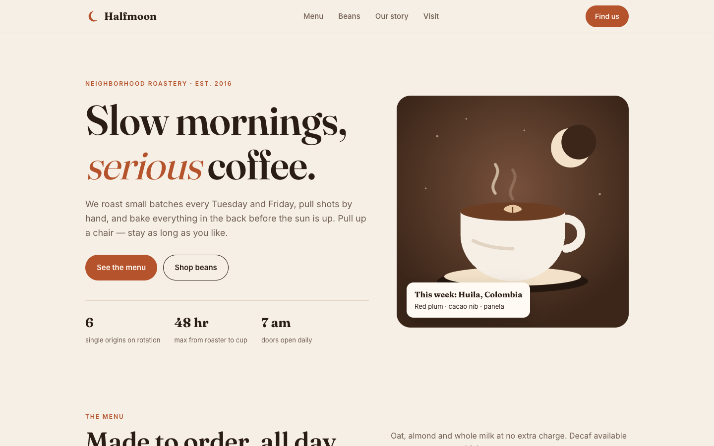
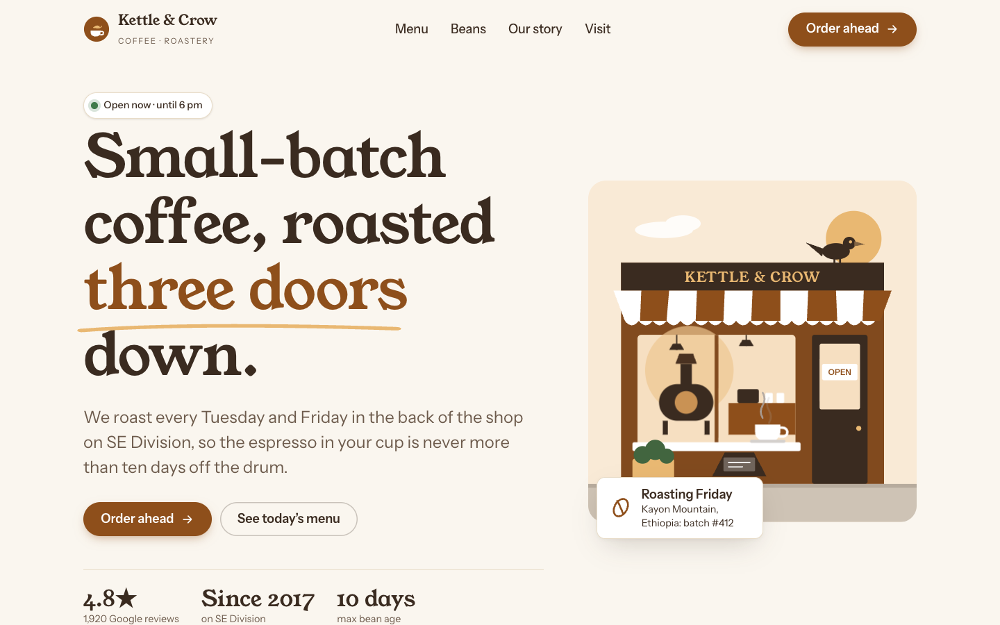
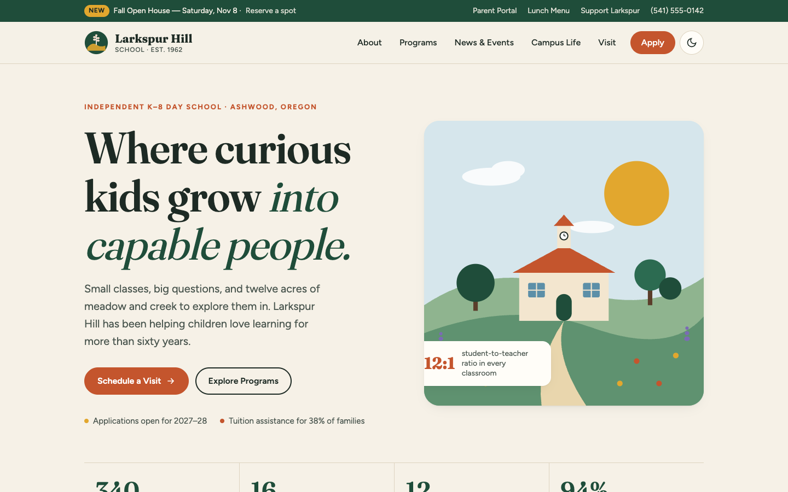
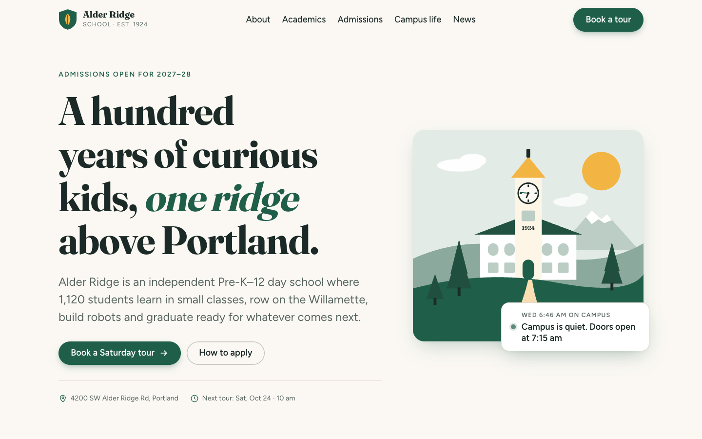

# frontend-taste

**An agent skill that makes AI-built websites look designed.** Give it a one-line prompt like *"build me a school website"* and it chooses a contrast-checked palette for the domain, a good font pairing, a hero layout, drawn illustrations, purposeful microinteractions, and a mobile-first layout, all without asking you a single design question.

Works with **Claude Code**, **Claude.ai**, and any agent that reads `SKILL.md` files.

<table>
<tr><th>Without the skill</th><th>With frontend-taste</th></tr>
<tr>
<td></td>
<td></td>
</tr>
<tr>
<td></td>
<td></td>
</tr>
</table>

<sub>Same model (Claude Opus 5.5), same one-line prompt, single self-contained HTML file. Full pages and mobile shots are in <a href="evals/runs">evals/runs</a>.</sub>

## Does it actually help? Measured.

We built 4 sites (school, coffee shop, dental clinic, SaaS landing page) twice each with the same model: once plain, once with the skill. Each page was then checked two ways.

**1. Automated audit:** each page is rendered in a real browser and checked against 34 checks (overflow at 5 widths, mobile nav, contrast, tap targets, type scale, motion, etc.).

| | Baseline | With skill |
|---|:-:|:-:|
| Average audit score | **78** / 100 | **100** / 100 |
| Text contrast passes WCAG | 0 / 4 sites | 4 / 4 |
| Tap targets ≥ 40px on mobile | 0 / 4 | 4 / 4 |
| Inputs ≥ 16px (no iOS zoom) | 0 / 4 | 4 / 4 |
| Hover effects gated for touch | 0 / 4 | 4 / 4 |
| Skip link | 1 / 4 | 4 / 4 |
| No horizontal scroll 320–1440px | 3 / 4 | 4 / 4 |
| Mobile menu actually opens | 3 / 4 | 4 / 4 |

**2. Blind visual judging:** a separate agent acting as a senior designer compared desktop and mobile screenshots labelled only A/B.

| | Baseline | With skill |
|---|:-:|:-:|
| Pairs won | 0 | **4 / 4** |
| Total overall score | 26 | **30** |

> **Honest note:** the *first* version of the skill only tied visually (28 vs 29). It fixed accessibility and mobile issues but made every hero look the same and filled pages with identical gradient "photo" boxes. The blind judge said so, and we fixed both problems (hero archetypes + an illustration guide). The full story, including the round we threw out because of a screenshot bug, is in [`evals/judging.md`](evals/judging.md). Sample size is small (n=4, one AI judge), so read it as directional.

## Install

**Claude Code (plugin):**
```
/plugin marketplace add musa-sohail/frontend-taste
/plugin install frontend-taste@frontend-taste
```

**Claude Code (script):** copies the skill to `~/.claude/skills/`:
```bash
curl -fsSL https://raw.githubusercontent.com/musa-sohail/frontend-taste/main/install.sh | bash
```

**Manual / other agents:** copy `skills/frontend-taste/` into your agent's skills folder (`~/.claude/skills/` or `.claude/skills/` in a project).

**Claude.ai:** zip `skills/frontend-taste/` and upload it in *Settings → Capabilities → Skills*.

No deployment or server is needed. A skill is just files the agent reads. Then ask for any frontend: *"build me a website for a yoga studio"*.

Optional: `npm i -D playwright` in your project lets the agent run the visual audit and screenshots on its own work.

## What the skill does

1. **Writes a brief:** domain, audience, three tone adjectives, the conversion goal, a hero archetype, and one signature idea specific to the brand.
2. **Picks a palette:** 20 hand-tuned palettes (light **and** dark) mapped to domains. Every one passes 8 WCAG contrast rules, enforced in CI. `palettes.mjs pick "<prompt>"` chooses automatically.
3. **Picks fonts:** 13 Google Fonts pairings matched to the palettes, plus a fluid `clamp()` type scale.
4. **Plans the page:** section recipes per site type, 8 hero archetypes, and composition rules (alternating rhythm, asymmetry, one focal point per section).
5. **Draws instead of using stock photos:** inline-SVG scenes and spot illustrations in palette colors, and HTML/CSS product mocks for SaaS.
6. **Adds microinteractions:** a catalog of 14 recipes using motion tokens. Buttons, cards, sticky header, mobile menu, reveals, count-ups, accordions, form states. All honor `prefers-reduced-motion`.
7. **Verifies:** a checklist, an anti-pattern list ("AI-site tells"), and `audit.mjs`, which renders the page and reports overflow, contrast, tap targets, and more, with screenshots for a visual pass.

## Repo layout

```
skills/frontend-taste/
  SKILL.md                 the workflow the agent follows
  references/
    palettes.md            20 palettes, domain map (generated from assets/palettes.json)
    typography.md          13 pairings, Google Fonts URLs, type scale
    layout.md              responsive system, hero archetypes, page recipes
    illustration.md        drawing on-brand inline-SVG art
    motion.md              motion tokens + 14 microinteraction recipes
    anti-patterns.md       what makes a site look AI-generated
    checklist.md           pre-ship QA
  assets/
    palettes.json          source of truth for colors
    starter.css            tokens, reset, layout primitives, components, motion
    micro.js               ~2KB reveal / count-up / sticky header / mobile nav / magnetic
  scripts/
    palettes.mjs           pick | css <id> | check | md
    audit.mjs              rendered-page audit (Playwright) + screenshots
evals/                     the before/after experiment (not needed to use the skill)
```

## Tools you can use directly

```bash
node skills/frontend-taste/scripts/palettes.mjs pick "a bakery in Lisbon"   # → oat-honey
node skills/frontend-taste/scripts/palettes.mjs css oat-honey              # → :root tokens, light + dark
node skills/frontend-taste/scripts/palettes.mjs check                      # → WCAG check of all palettes
node skills/frontend-taste/scripts/audit.mjs index.html --shots out/       # → score + screenshots
```

## Rerun the evals

```bash
npm i
node evals/run-audit.mjs        # audits every evals/runs/*/*/index.html, writes evals/results.md
```
See [`evals/README.md`](evals/README.md) for how to add a prompt.

## License

MIT © Musa Sohail
